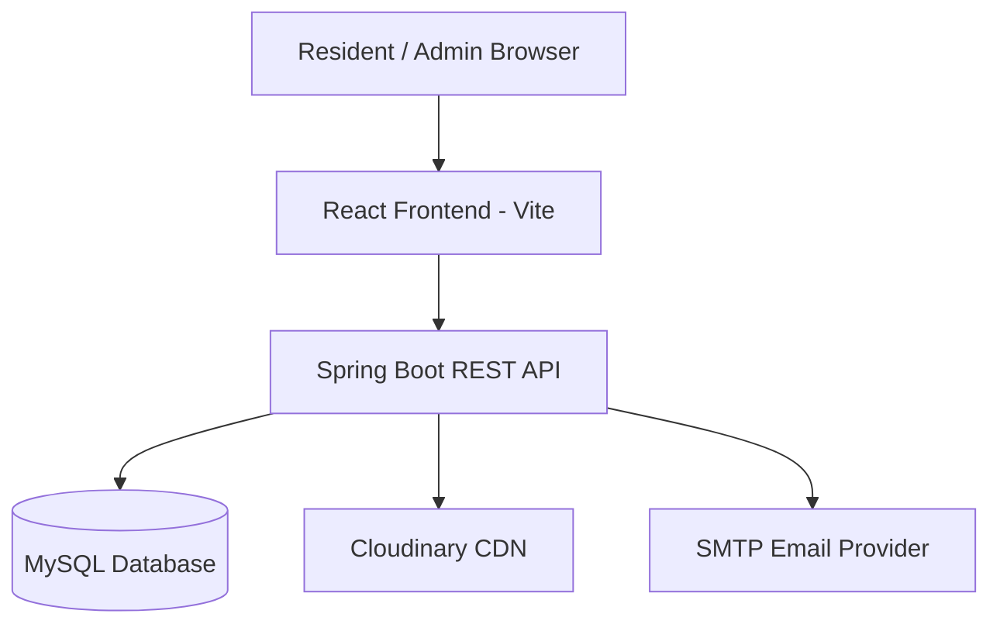

# System Design — Society Maintenance Tracker

## Architecture Overview



The system follows a standard three-tier architecture: a React SPA frontend, a Spring Boot REST API backend, and a MySQL relational database. Cloudinary handles photo storage and an SMTP provider handles email delivery.

---

## 1. Complaint History Model

Every status transition is stored as an immutable row in `complaint_status_history`. The table captures `complaint_id`, `old_status`, `new_status`, `changed_by` (FK to users), `changed_at` (timestamp), and an optional `note`. The initial complaint creation also writes a history row with `old_status = NULL` and `new_status = OPEN`, establishing a complete audit trail from the moment of submission.

A separate `complaint_priority_history` table follows the same pattern for priority changes. Both tables are append-only — rows are never updated or deleted. The frontend fetches history on demand per complaint to avoid over-fetching on list views.

Status transitions are validated in `ComplaintService.validateStatusTransition()`:
- `RESOLVED → anything` is rejected
- `OPEN → RESOLVED` directly is rejected (must pass through `IN_PROGRESS`)
- Duplicate transitions (same status) are rejected

Every successful status change is wrapped in a `@Transactional` method so the complaint update and history insert are atomic.

---

## 2. Overdue Detection

A configurable `COMPLAINT_OVERDUE_DAYS` environment variable (default: 3) drives overdue logic. Two mechanisms work together:

**Scheduled job** — `@Scheduled(fixedRate = 3600000)` runs every hour and executes a single bulk `UPDATE` query:
```sql
UPDATE complaints SET is_overdue = TRUE
WHERE status != 'RESOLVED' AND is_overdue = FALSE
AND created_at < NOW() - INTERVAL N DAY
```

This is efficient — one query marks all newly overdue complaints in a single pass. The threshold is read from `@Value("${app.complaint.overdue-days}")` so it never requires a code change.

**Business rule enforcement** — when a complaint is resolved, `is_overdue` is immediately set to `false` so resolved complaints never appear overdue. Overdue complaints are sorted first in admin queries via `ORDER BY is_overdue DESC`.

---

## 3. Photo Handling

Photos are uploaded to **Cloudinary** rather than stored in MySQL or the local filesystem. The flow:

1. Resident submits `multipart/form-data` with `data` (JSON part) and optional `photo` (file part).
2. `CloudinaryService.upload()` validates file type (JPG/PNG/WEBP only) and size (≤ 5 MB) before uploading.
3. Cloudinary returns a `secure_url` and `public_id`. Only these strings are stored in MySQL (`photo_url`, `photo_public_id`).
4. The frontend renders the Cloudinary URL directly — no proxying through the backend.

This design means the backend never holds binary data in memory beyond the upload request. Swapping to S3 requires only changing `CloudinaryService` — the entity and API contract remain unchanged.

---

## 4. Notification Flow

Email is handled by `EmailService` using Spring's `JavaMailSender`. Two triggers exist:

**Status change** — `ComplaintService.updateStatus()` calls `emailService.sendStatusChangeEmail()` after the database transaction commits. The email contains complaint ID, title, old/new status, admin note, and timestamp.

**Important notice** — `NoticeService.createNotice()` fetches all residents from the database and calls `emailService.sendImportantNoticeEmail()` for each. Both methods are annotated `@Async` so they run on a separate thread pool and never block the HTTP response.

Email failures are caught and logged (`log.error(...)`) but never re-thrown. This means a temporary SMTP outage cannot corrupt a complaint update or notice creation — the database transaction is already committed before the email attempt.

---

## 5. Authentication

JWT tokens are issued on login/register and contain `userId`, `email`, `role`, and expiration. `JwtAuthenticationFilter` intercepts every request, extracts the Bearer token, validates it via `JwtService`, and populates `SecurityContextHolder`. Spring Security's `@EnableMethodSecurity` and route-level `hasRole()` rules enforce authorization. Passwords are hashed with `BCryptPasswordEncoder` (strength 10) and never stored or logged in plain text.

---

## 6. Database Relationships

```
users 1 ──< complaints (resident_id)
complaints 1 ──< complaint_status_history (complaint_id)
complaints 1 ──< complaint_priority_history (complaint_id)
users 1 ──< notices (created_by)
complaint_status_history >── users (changed_by)
complaint_priority_history >── users (changed_by)
```

All foreign keys use `ON DELETE CASCADE` for complaints so deleting a user removes their complaints and all associated history. Indexes are placed on all commonly filtered columns: `status`, `category`, `priority`, `is_overdue`, `resident_id`, `created_at`.

---

## 7. Scalability Considerations

- **Stateless API** — JWT authentication means any backend instance can serve any request. Horizontal scaling behind a load balancer requires no session affinity.
- **Async email** — `@Async` with a configurable thread pool prevents email latency from affecting API response times.
- **Cloudinary CDN** — photos are served from Cloudinary's global CDN, not the backend server.
- **Pagination** — all list endpoints use Spring Data `Pageable` to avoid loading unbounded result sets.
- **Scheduled overdue check** — a single bulk SQL UPDATE is far more efficient than per-complaint checks on every request.
- **Production upgrade path** — replace the scheduled job with a dedicated cron service; replace Cloudinary with S3; replace SMTP with a transactional email API (SendGrid/Resend) for higher throughput.
